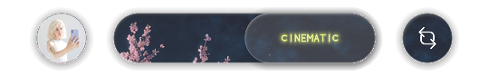

<div align="center">

# 🪟 Liquid Glass

**True Apple-Grade Physical Liquid Glass & Optical Lensing Engine for Wayland**

[](https://www.rust-lang.org)
[](https://wgpu.rs)
[](https://wayland.freedesktop.org)
[](https://www.w3.org/TR/WGSL/)
[](LICENSE)

<br />

<p align="center">
  
</p>

*Physical plano-convex Snell refraction, chromatic dispersion, directional meniscus edge lighting, and fluid harmonic spring kinetics matching [liquidglassdesign.com](https://liquidglassdesign.com/gallery/liquid-glass-camera-toolbar) running natively on Wayland.*

</div>

---

## ✨ Features

- **💎 Authentic Liquid Glass Optics**: Snell's Law refraction ($IOR = 1.33 - 1.52$) and true background magnification through continuous WGSL Signed Distance Fields (SDF).
- **🌈 Spectral Chromatic Dispersion**: Prismatic wavelength splitting ($RGB$ offsets) across curved meniscus edges and chamfered rims.
- **📷 Liquid Glass Camera Toolbar**: Serene, floating 3-element toolbar inspired by [liquidglassdesign.com](https://liquidglassdesign.com/gallery/liquid-glass-camera-toolbar):
  - **Left Disc**: Circular gallery preview with crystalline lens bevel.
  - **Center Track**: Clear liquid glass capsule with a nested sliding pill exhibiting radiant lemon-gold typography (`CINEMATIC`, `PHOTO`, `VIDEO`).
  - **Right Disc**: Circular camera-flip button with precision vector bent-arrow iconography.
- **☀️ Directional Rim Lighting**: 1.5px luminous specular meniscus catch aligned to directional solar light.
- **⚡ Reactive Spring Kinetics**: Second-order underdamped harmonic oscillator (`k=260`, `c=18`) for seamless mode switching and fluid cursor stretch.
- **🍃 Zero-Power Idle Loop**: Auto-sleeps once springs settle. Idle state consumes **0.0% CPU / GPU**, waking up instantly on cursor interaction.
- **🖥️ Native Wayland Integration**: Built on `smithay-client-toolkit` and `wlr-layer-shell`, floating transparently above desktop wallpapers.

---

## 🔬 Optical Pipeline

```
       Incoming Light Ray
             │
             ▼
┌───────────────────────────────┐
│     Plano-Convex Chamfer      │ ──► Normal Map Gradient (∇h)
└────────────┬──────────────────┘
             ▼
┌───────────────────────────────┐
│     Snell Refraction (IOR)    │ ──► Barrel Distortion & Magnification
└────────────┬──────────────────┘
             ▼
┌───────────────────────────────┐
│     Spectral Dispersion       │ ──► Wavelength Separation (RGB offsets)
└────────────┬──────────────────┘
             ▼
┌───────────────────────────────┐
│     Dual Blinn-Phong Sheen    │ ──► Micro-Surface Specular + Spotlight
└────────────┬──────────────────┘
             ▼
┌───────────────────────────────┐
│     Fresnel Edge Catch        │ ──► Grazing-Angle Luminescence
└───────────────────────────────┘
```

---

## 🛠️ Architecture

| Crate | Responsibility |
|---|---|
| **`glass-core`** | WGPU rendering backend, WGSL optical shaders, pipeline caching, uniform bindings. |
| **`glass-platform`** | Wayland Layer Shell, X11/wlroots abstractions, native window handles. |
| **`glass-ui`** | Component abstractions, geometry descriptors, and material parameter definitions. |
| **`glass-panel`** | Floating Camera Toolbar widget with gallery preview, sliding mode pill, and flip button. |

---

## 🚀 Quickstart

### Prerequisites

Ensure you have the Vulkan loader and Wayland libraries installed:

```bash
# Arch Linux
sudo pacman -S rust vulkan-radeon vulkan-intel wayland grim

# Ubuntu / Debian
sudo apt install cargo libvulkan-dev libwayland-dev
```

### Build & Run

```bash
# Clone repository
git clone https://github.com/ziuus/liquid-glass.git
cd liquid-glass

# Run optimized release build
cargo run -p glass-panel --release
```

### Capture GPU Snapshot

To capture a lossless offscreen frame directly from the swapchain buffer:

```bash
GLASS_SNAPSHOT=snapshot.png cargo run -p glass-panel --release
```

---

## 🎛️ Material Configuration

Surfaces can be customized through the fluent builder API:

```rust
use glass_core::{GlassSurface, Material, geometry::Shape};

let panel = GlassSurface::new()
    .material(Material::LiquidGlass)
    .shape(Shape::RoundedRectangle { radius: 28.0 })
    .bounds(0.0, 0.0, 1.0, 1.0)
    .curvature(0.08)       // Optical dome curvature
    .bevel(10.0)           // Chamfer edge radius in px
    .refraction(0.24)      // Background displacement magnitude
    .dispersion(0.010)     // Chromatic aberration spread
    .blur(3.5)             // Creamy frosted backdrop blur radius
    .specular(0.25)        // Ambient Blinn-Phong reflection
    .fresnel(0.40);        // Grazing angle reflection
```

---

## 📜 License

Distributed under the **MIT License**. See [`LICENSE`](LICENSE) for details.
