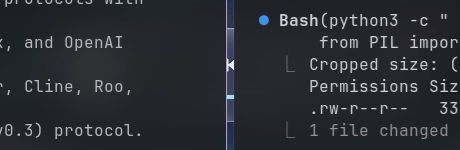
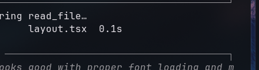

<div align="center">

# 🪟 Liquid Glass

**Apple-Grade Physical Liquid Glass & Optical Lensing Engine for Linux & Wayland**

[](https://github.com/ziuus/liquid-glass/actions/workflows/ci.yml)
[](https://www.rust-lang.org)
[](https://wgpu.rs)
[](https://wayland.freedesktop.org)
[](https://www.w3.org/TR/WGSL/)
[](LICENSE)
[](CONTRIBUTING.md)

<br />

<p align="center">
  
</p>

*Live capture: Physical plano-convex Snell refraction, chromatic dispersion, directional meniscus edge lighting, and fluid harmonic spring kinetics powering a serene floating Media Control Island on Wayland.*

<p align="center">
  <a href="#-quickstart">Quickstart</a> •
  <a href="#-showcase-demos">Showcase Demos</a> •
  <a href="#-building-with-liquid-glass">Component API</a> •
  <a href="#-contributing--getting-involved">Contribute</a> •
  <a href="docs/USAGE_GUIDE.md">Docs & HIG</a>
</p>

</div>

---

## 🌟 Highlights

- **💎 Authentic Optical Lensing**: Real-time Snell's Law refraction ($IOR = 1.33 - 1.52$), chromatic wavelength dispersion ($RGB$ edge separation), and dual-lobe specular highlights.
- **🎨 High-Level Component Framework (`glass-ui`)**: Pre-built, interactive `GlassCard`, `GlassButton`, `GlassToggle`, and `GlassSlider` with spring-driven tactile states.
- **⚡ Reactive Kinematics (`glass-core::animation`)**: Sub-stepped Runge-Kutta (RK4) spring physics and fluid velocity deformation for tactile interactions.
- **🖥️ Dual Deployment Targets**:
  - **Windowed Desktop Apps**: Cross-platform desktop windows via `winit` and `wgpu`.
  - **Wayland Desktop Widgets**: Seamless floating surfaces via `zwlr_layer_shell_v1` with real-time wallpaper sampling and **0.0% CPU idle**.
- **🎧 Dynamic Media Control Island**: Interactive audio widget with rotating vinyl grooves, reactive equalizer bars, scrubber timeline, and MPRIS integration.

---

## 📸 Showcase Demos

| Live Media Island Widget (`glass-panel`) | Desktop Component Demo (`simple-window`) |
|:---:|:---:|
|  |  |
| *Floating Wayland layer-shell widget with live equalizer & MPRIS control* | *Interactive windowed UI components (Buttons, Toggles, Sliders)* |

---

## 📦 Workspace Architecture

```
liquid-glass/
├── glass-core/        # Optical rendering pipeline, WGSL shaders, materials, spring physics
├── glass-ui/          # High-level components (Buttons, Toggles, Sliders, Cards, Islands)
├── glass-platform/    # Platform capabilities and Wayland / compositor bindings
├── examples/
│   ├── glass-panel/   # Wayland layer-shell floating Media Control Island widget
│   ├── simple-window/ # Windowed desktop app showcasing glass-ui components
│   ├── simple-demo/   # CLI animation & material physics demo
│   └── sdl-widget/    # SDL2 surface integration demo
└── docs/              # Research papers, material guides, and architectural notes
```

---

## 🚀 Quickstart

### Prerequisites

Ensure you have Vulkan drivers and Wayland development packages:

```bash
# Arch Linux
sudo pacman -S rust vulkan-radeon vulkan-intel wayland grim

# Ubuntu / Debian
sudo apt install cargo libvulkan-dev libwayland-dev libxkbcommon-dev
```

### Run Examples

```bash
# 1. Run the interactive Wayland Media Island Widget (floating desktop pill)
cargo run -p glass-panel --release

# 2. Run the Windowed Desktop Component Demo (winit + glass-ui)
cargo run -p simple-window

# 3. Run the Materials & Physics Terminal Showcase
cargo run -p simple-demo
```

---

## 🧩 Building with Liquid Glass

### 1. Building UI Components (`glass-ui`)

Assembling a liquid glass UI with interactive buttons, toggles, and sliders:

```rust
use glass_ui::{GlassWidget, GlassCard, GlassButton, GlassToggle, GlassSlider};

// 1. Initialize widget container
let mut widget = GlassWidget::new();

// 2. Add floating background card / island
widget.add_card(GlassCard::island(0.1, 0.1, 0.8, 0.8).blur(32.0).specular(1.0));

// 3. Add interactive components with tactile spring physics
widget.add_button(GlassButton::new(0.15, 0.25, 0.30, 0.10, "Play"));
widget.add_toggle(GlassToggle::new(0.50, 0.25, 0.15, 0.08, true));
widget.add_slider(GlassSlider::new(0.15, 0.50, 0.70, 0.05, 0.65));

// 4. In your event loop:
widget.on_pointer_move(cursor_x, cursor_y);
if mouse_pressed {
    widget.on_pointer_down(cursor_x, cursor_y);
}
widget.update(delta_time);

// 5. Collect render surfaces for WGPU
let surfaces = widget.collect_surfaces();
renderer.render(&surfaces)?;
```

### 2. Building a Desktop App Window (`winit` + `glass-core`)

```rust
use glass_core::{GlassRenderer, GlassSurface, Material, geometry::Shape};
use winit::window::WindowBuilder;

let window = Arc::new(WindowBuilder::new()
    .with_title("Glass App")
    .with_transparent(true)
    .build(&event_loop)?);

let mut renderer = GlassRenderer::new(window.clone(), width, height).await?;

let surfaces = vec![
    GlassSurface::new()
        .material(Material::LiquidGlass)
        .shape(Shape::Capsule)
        .bounds(0.1, 0.1, 0.8, 0.8)
        .refraction(0.70)
        .dispersion(0.04)
        .specular(1.0)
];

renderer.render(&surfaces)?;
```

### 3. Calibrated Apple Vibrancy Materials

```rust
use glass_core::{GlassMaterial, MaterialType};

// Pre-calibrated materials matching Apple HIG & NSVisualEffectView:
let sidebar = GlassMaterial::new(MaterialType::Sidebar);
let hud     = GlassMaterial::new(MaterialType::HUD);
let menu    = GlassMaterial::menu().with_corner_radius(12.0);
```

---

## 🤝 Contributing & Getting Involved

We welcome contributors of all levels! Here's how you can help:

- **Add New Widgets**: Help build `GlassTextInput`, `GlassTooltip`, `GlassContextMenu` in `glass-ui`.
- **Compositor Extensions**: Enhance `glass-platform` for Hyprland, Sway, KDE, and COSMIC blur protocols.
- **Shader Optimization**: Further refine WGSL optical dispersion and fluid meniscus curves.
- **Showcase Apps**: Build new desktop widgets (e.g. Weather, Clock, System Monitor) and share screenshots!

Check out our [**Contributing Guide**](CONTRIBUTING.md) to get started.

---

## 📚 Documentation & Research

- [**Usage & Material Guide**](docs/USAGE_GUIDE.md): Deep dive into materials, blend modes, and layering.
- [**Apple Design System Analysis**](docs/LIQUID_GLASS_ANALYSIS.md): Analysis of macOS/visionOS blur, vibrancy, and optical thickness.
- [**Fluid Dynamics Research**](docs/FLUID_DYNAMICS_RESEARCH.md): Physical equations for surface tension, contact angle, and viscous damping.
- [**Transformation Summary**](docs/TRANSFORMATION_SUMMARY.md): Evolution of the engine architecture.

---

## 📜 License

Distributed under the **MIT License**. See [`LICENSE`](LICENSE) for details.
