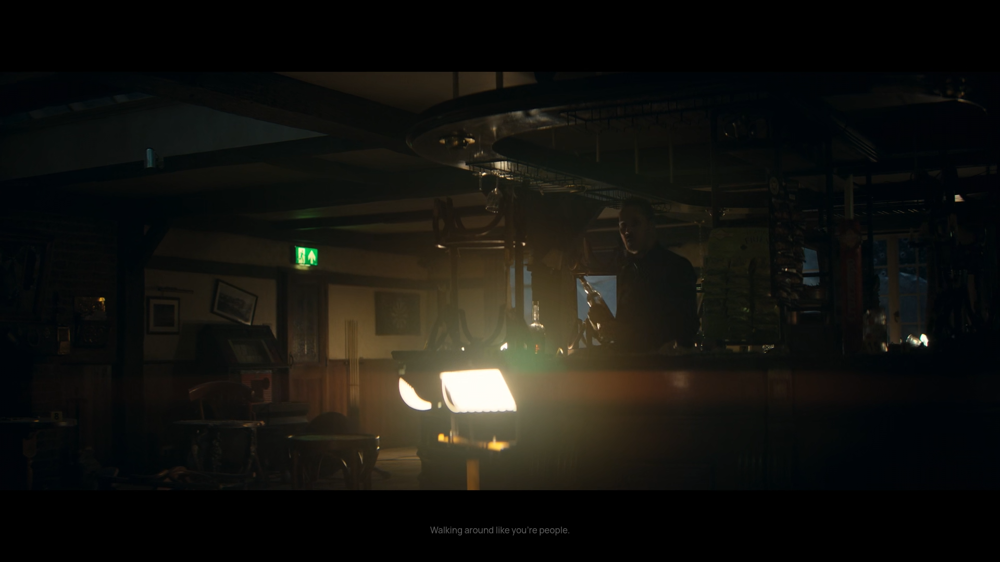
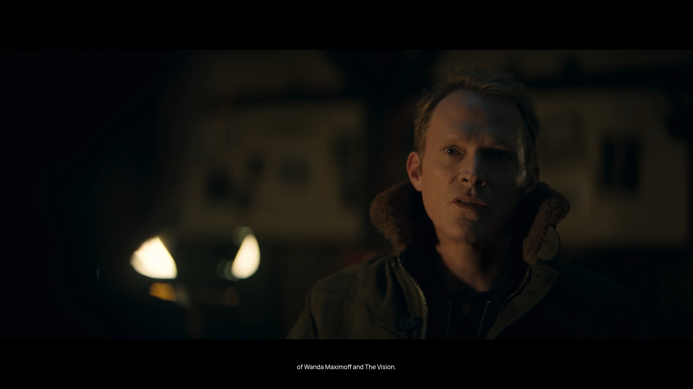
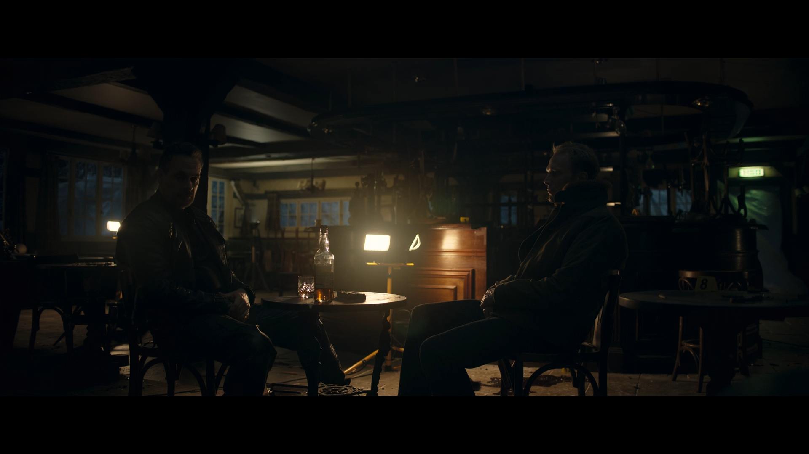

<div align="center">

# 🌊 Liquid Glass

### Cross-Platform Physical Optical Lensing & Glassmorphism UI Engine (Linux · Windows)

> **Atlantis Shells**: [Linux / Wayland (`atlantis`)](https://github.com/ziuus/atlantis) · [Windows (`atlantis-win`)](https://github.com/ziuus/atlantis-win)

[](https://www.rust-lang.org)
[](https://aur.archlinux.org/packages/liquid-glass-git)
[](https://wgpu.rs)
[](https://wayland.freedesktop.org)
[](https://www.w3.org/TR/WGSL/)
[](LICENSE)
[](https://devhunt.org/tool/liquid-glass)

<br />

| Crystalline Light Optical Refraction | Deep Dark Foliage Optical Refraction |
| :---: | :---: |
|  |  |

<br />



*Physical plano-convex Snell refraction, Cauchy chromatic dispersion (RGB edge separation), directional 7px contact shadows, and tactile spring kinetics running natively on Wayland.*

<br />

---

</div>

> [!TIP]
> **Looking for the turnkey Wayland desktop environment & rice?**  
> Check out [**🔱 Atlantis**](https://github.com/ziuus/atlantis) — the complete desktop rice featuring the Dynamic Island, 3D Hero Clock, App Dock, Tasks Island, audio switcher, and `island-ctl` IPC, powered by this engine.

> Building this in the open — if it saves you time, a star helps others find it.
> Found a bug, or have an idea? [Open an issue](https://github.com/ziuus/liquid-glass/issues).
> New here? Start with a [good first issue](https://github.com/ziuus/liquid-glass/issues?q=is%3Aissue+is%3Aopen+label%3A%22good+first+issue%22).
> Component proposals and bug reports welcome.

## 🌟 Why Liquid Glass?

Most "glassmorphism" effects in modern web and desktop apps are superficial: they simply stack a flat 2D box-blur over a dimmed background. 

**Real optical glass interacts dynamically with light and geometry.** Liquid Glass models real physical optics directly in custom WGSL shaders:

| Optical Property | Standard Glassmorphism | Liquid Glass Engine |
| :--- | :--- | :--- |
| **Refraction** | ❌ None (Flat blur) | ✅ **Snell's Law ray-bending** through plano-convex lens domes |
| **Dispersion** | ❌ None | ✅ **Cauchy chromatic aberration** (RGB wavelength splitting at bevels) |
| **Fresnel Response** | ❌ Constant opacity | ✅ **Schlick's approximation** (grazing angles gleam with total internal reflection) |
| **Meniscus Edges** | ❌ Simple border stroke | ✅ **Directional sunlight highlights** + zero artificial cartoon strokes |
| **Contact Shadows** | ❌ Heavy black smudge | ✅ **Directional 7px contact shadows** with cubic smoothstep wallpaper blending |
| **Curvature & Kinks** | ⚠️ Faceted slope jumps | ✅ **Zero-slope $C^1$ profile** eliminating boundary kinks |
| **Idle Overhead** | ⚠️ Constant redraws / CPU burn | ✅ **0.0% CPU Idle** via event-driven kernel `epoll_wait` |
| **Fragment Cost** | ⚠️ Fullscreen canvas redraws | ✅ **Tight bounded quads** — zero background overdraw |

<br />

## 📦 Architecture

The workspace is organized into modular, purpose-built crates:

```
liquid-glass/
├── glass-core/        # Headless optical engine: Snell refraction, Cauchy dispersion, WGPU pipelines, RK4 physics
│   ├── renderer/      # Bounded quad pipeline, dynamic uniform offsets, glass.wgsl shaders
│   ├── material/      # Physical material profiles (LiquidGlass, Frosted, Acrylic, Obsidian)
│   ├── animation/     # Sub-stepped Runge-Kutta 4 (RK4) spring kinetics
│   └── geometry/      # Procedural SDF shapes (Capsule, RoundedRect, Notched docked island)
├── glass-platform/    # Wayland/X11 layer-shell protocols, awww/swww inotify wallpaper sync, luminance detection
├── glass-ui/          # Declarative retained-mode UI widgets (GlassCard, GlassButton, GlassToggle, GlassSlider)
└── examples/
    ├── simple-window/ # Cross-platform desktop window playground (winit + wgpu)
    ├── simple-demo/   # Refraction & physical optical parameter showcase
    └── sdl-widget/    # SDL2 embedded widget integration example
```

<br />

## ⚡ Quickstart

### Rust Cargo Dependency
Add `glass-core` and `glass-ui` to your `Cargo.toml`:

```toml
[dependencies]
glass-core = { git = "https://github.com/ziuus/liquid-glass" }
glass-ui   = { git = "https://github.com/ziuus/liquid-glass" }
```

### Building a Tactile Glass Interface

```rust
use glass_ui::{GlassWidget, GlassCard, GlassButton, GlassToggle, GlassSlider};
use glass_core::geometry::Shape;
use glass_core::Material;

let mut widget = GlassWidget::new();

// 1. Floating Glass Container Island
widget.add_card(
    GlassCard::new(0.1, 0.1, 0.8, 0.6)   // normalized coords (0–1)
        .shape(Shape::Capsule)
        .blur(0.0)
        .refraction(16.0)
        .dispersion(0.12)
        .bevel(14.0),
);

// 2. Interactive Tactile Controls
widget.add_button(GlassButton::new(0.20, 0.30, 0.25, 0.12, "Play"));
widget.add_toggle(GlassToggle::new(0.55, 0.30, 0.15, 0.08, true));
widget.add_slider(GlassSlider::new(0.20, 0.50, 0.60, 0.05, 0.45));

// 3. Event Loop Interaction & Single-Pass Render
widget.on_pointer_move(cursor_x, cursor_y);
widget.update(delta_time);

let surfaces = widget.collect_surfaces();
renderer.render(&surfaces)?;
```

<br />

## 🚀 Running Examples

### 1. Cross-Platform Desktop Window (`winit`)
Cross-platform desktop playground running on standard WGPU (Linux, macOS, Windows):

```bash
cargo run --release -p simple-window
```

### 2. Refraction & Optical Showcase
Demonstrates Snell's law refraction, Cauchy chromatic dispersion, and lens curvature parameters:

```bash
cargo run --release -p simple-demo
```

### 3. Embedded SDL2 Widget
Demonstrates embedding the liquid glass pipeline inside an existing SDL2 application:

```bash
cargo run --release -p sdl-widget
```

<br />

## 🔱 Related Repositories

- **Desktop Shell & Complete Rice**: [**🔱 Atlantis**](https://github.com/ziuus/atlantis) — Turnkey Wayland desktop environment with Dynamic Island, 3D Hero Clock, App Dock, and Agenda Island built on this engine.
- **Design Research & Promotional Lab**: [**🗃️ liquid-glass-archive**](https://github.com/ziuus/liquid-glass-archive) — Historical Snell refraction papers, early UI mockups, launch kits, and promotional media archives.

<br />

## 🔬 Under the Hood

### 1. Plano-Convex Lens Refraction & Dispersion
Surface normals $N$ are computed procedurally in screen-space from heightfield gradients:

$$N = \text{normalize}\begin{pmatrix} -\nabla h_x \\ -\nabla h_y \\ 1 \end{pmatrix}$$

Refraction rays bend the background texture coordinates across separate color wavelengths (red, green, blue) according to Cauchy's dispersion formula:

$$\vec{uv}_{\text{color}} = \vec{uv} + (N_{xy} \cdot \eta_{\text{base}}) \pm \vec{\Delta}_{\text{dispersion}}$$

### 2. Zero-Overdraw Bounded Quads
Rather than blitting full-screen post-processing passes over the desktop, `GlassRenderer` rasterizes **tight clipped bounding quads** fitted to each individual glass surface with dynamic uniform buffer offsets (`has_dynamic_offset: true`). Fragment shaders execute exclusively inside the bounding footprint of the glass lens.

### 3. Sub-Stepped Spring Physics
Buttons and sliders use Runge-Kutta 4 (RK4) integration with configurable damping and stiffness presets (`snappy`, `smooth`, `bouncy`), delivering tactile compression and fluid recovery upon click or release.

<br />

## 🤝 Contributing

Contributions, bug reports, and component proposals are warmly welcome! 
Check out [CONTRIBUTING.md](CONTRIBUTING.md) to get started with development and architectural guidelines.

<br />

## 📄 License

Licensed under the [MIT License](LICENSE).
