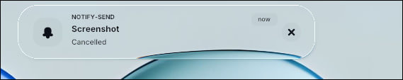
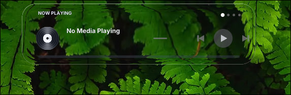
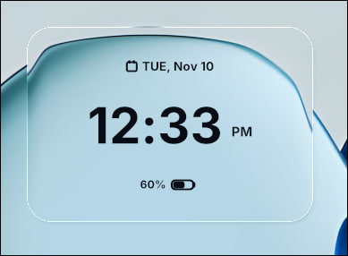
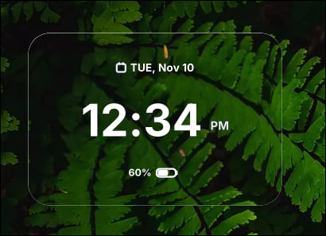

<div align="center">

# 🌊 Liquid Glass

### Physical Optical Lensing & Glassmorphism UI Engine for Linux & Wayland

[](https://www.rust-lang.org)
[](https://aur.archlinux.org/packages/liquid-glass-git)
[](https://wgpu.rs)
[](https://wayland.freedesktop.org)
[](https://www.w3.org/TR/WGSL/)
[](LICENSE)
[](https://devhunt.org/tool/liquid-glass)

<br />

| Crystalline Light Mode (Physical Refraction & Specular Glint) | Deep Dark Foliage Mode (Chlorophyll Backing & Ambient Rim) |
| :---: | :---: |
|  |  |
|  |  |

*Physical plano-convex Snell refraction, Cauchy chromatic dispersion (RGB edge separation), directional 7px contact shadows, and tactile spring kinetics running natively on Wayland.*

<br />

---

</div>

> Building this in the open — if it saves you time, a star helps others find it.
> Found a bug, or have an idea? [Open an issue](https://github.com/ziuus/liquid-glass/issues).
> New here? Start with a [good first issue](https://github.com/ziuus/liquid-glass/issues?q=is%3Aissue+is%3Aopen+label%3A%22good+first+issue%22).
> Component proposals and bug reports welcome.

## 🌟 Why Liquid Glass?

Most "glassmorphism" effects in modern web and desktop apps are superficial: they simply stack a flat 2D box-blur over a dimmed background. 

**Real optical glass interacts dynamically with light and geometry.** Liquid Glass models real physical optics directly in custom WGSL shaders:

| Optical Property | Standard Glassmorphism | Liquid Glass Engine |
| :--- | :--- | :--- |
| **Refraction** | ❌ None (Flat blur) | ✅ **Snell's Law ray-bending** through plano-convex lens domes |
| **Dispersion** | ❌ None | ✅ **Cauchy chromatic aberration** (RGB wavelength splitting at bevels) |
| **Fresnel Response** | ❌ Constant opacity | ✅ **Schlick's approximation** (grazing angles gleam with total internal reflection) |
| **Meniscus Edges** | ❌ Simple border stroke | ✅ **Directional sunlight highlights** + zero artificial cartoon strokes |
| **Contact Shadows** | ❌ Heavy black smudge | ✅ **Directional 7px contact shadows** with cubic smoothstep wallpaper blending |
| **Curvature & Kinks** | ⚠️ Faceted slope jumps | ✅ **Zero-slope $C^1$ profile** eliminating boundary kinks |
| **Idle Overhead** | ⚠️ Constant redraws / CPU burn | ✅ **0.0% CPU Idle** via event-driven kernel `epoll_wait` |
| **Fragment Cost** | ⚠️ Fullscreen canvas redraws | ✅ **Tight bounded quads** — zero background overdraw |

<br />

## 📦 Architecture

The workspace is organized into modular, purpose-built crates:

```
liquid-glass/
├── glass-core/        # Headless optical engine: Snell refraction, Cauchy dispersion, WGPU pipelines, RK4 physics
│   ├── renderer/      # Bounded quad pipeline, dynamic uniform offsets, glass.wgsl shaders
│   ├── material/      # Physical material profiles (LiquidGlass, Frosted, Acrylic, Obsidian)
│   ├── animation/     # Sub-stepped Runge-Kutta 4 (RK4) spring kinetics
│   └── geometry/      # Procedural SDF shapes (Capsule, RoundedRect, Notched docked island)
├── glass-platform/    # Wayland/X11 layer-shell protocols, awww/swww inotify wallpaper sync, luminance detection
├── glass-ui/          # Declarative retained-mode UI widgets (GlassCard, GlassButton, GlassToggle, GlassSlider)
└── examples/
    ├── liquid-shell/  # Flagship desktop shell: Dynamic Island, Swiss Analog Dial, Digital Clock, Tasks panel
    ├── glass-panel/   # Wayland layer-shell floating media island
    ├── glass-clock/   # Standalone physical liquid glass clock widget
    ├── glass-todo/    # Standalone glass task management widget
    └── simple-window/ # Cross-platform desktop window playground (winit + wgpu)
```

<br />

## ⚡ Quickstart

### Arch Linux (AUR)
Install all liquid-glass demo binaries (`glass-panel`, `glass-clock`, `glass-todo`):
```bash
yay -S liquid-glass-git
# Or using paru:
paru -S liquid-glass-git
```

### Rust Cargo Dependency
Add `glass-core` and `glass-ui` to your `Cargo.toml`:

```toml
[dependencies]
glass-core = { git = "https://github.com/ziuus/liquid-glass" }
glass-ui   = { git = "https://github.com/ziuus/liquid-glass" }
```

### Building a Tactile Glass Interface

```rust
use glass_ui::{GlassWidget, GlassCard, GlassButton, GlassToggle, GlassSlider};
use glass_core::geometry::Shape;
use glass_core::Material;

let mut widget = GlassWidget::new();

// 1. Floating Glass Container Island
widget.add_card(
    GlassCard::new(0.1, 0.1, 0.8, 0.6)   // normalized coords (0–1)
        .shape(Shape::Capsule)
        .blur(0.0)
        .refraction(16.0)
        .dispersion(0.12)
        .bevel(14.0),
);

// 2. Interactive Tactile Controls
widget.add_button(GlassButton::new(0.20, 0.30, 0.25, 0.12, "Play"));
widget.add_toggle(GlassToggle::new(0.55, 0.30, 0.15, 0.08, true));
widget.add_slider(GlassSlider::new(0.20, 0.50, 0.60, 0.05, 0.45));

// 3. Event Loop Interaction & Single-Pass Render
widget.on_pointer_move(cursor_x, cursor_y);
widget.update(delta_time);

let surfaces = widget.collect_surfaces();
renderer.render(&surfaces)?;
```

<br />

## 🚀 Running & Installing

### 1. Liquid Shell (Flagship Wayland Desktop Shell)
Features the Dynamic Island, System Clock, Task panel, Bottom Dock, and desktop widgets with real-time physical optical glass refraction:

```bash
# Build & install to ~/.local/bin/liquid-shell and set up ~/.config/liquid-glass/config.json
./install.sh

# Install with systemd autostart (recommended)
./install.sh --systemd

# Or run directly (without installing)
cargo run --release -p liquid-shell
```

**Hyprland Autostart** (`~/.config/hypr/hyprland.conf`):
```ini
exec-once = liquid-shell
```

**Configuration** (`~/.config/liquid-glass/config.json`):
*Monitored via inotify — updates styles, themes, and dimensions live without process restarts.*

```json
{
  "theme_mode": 0,
  "style_mode": 2.0,
  "blur_radius": 0.0,
  "animation_speed": 1.0,
  "island": {
    "edge_style": "curved",
    "fillet_radius_compact": 10.0,
    "fillet_radius_expanded": 24.0,
    "hover_to_expand": true,
    "style_mode": 2.0,
    "quick_access": [
      { "name": "Terminal", "command": "foot",    "icon": "terminal" },
      { "name": "Browser",  "command": "brave",   "icon": "browser"  },
      { "name": "Editor",   "command": "code",    "icon": "editor"   },
      { "name": "Files",    "command": "thunar",  "icon": "files"    },
      { "name": "Music",    "command": "spotify", "icon": "music"    }
    ]
  },
  "clock": {
    "enabled": true,
    "edge_style": "curved",
    "style_mode": 2.0
  },
  "dock": {
    "enabled": true,
    "hover_to_expand": true,
    "style_mode": 2.0,
    "apps": [
      { "name": "Terminal", "command": "foot",    "icon": "terminal", "class": "foot"   },
      { "name": "Browser",  "command": "brave",   "icon": "browser",  "class": "brave"  },
      { "name": "Editor",   "command": "code",    "icon": "editor",   "class": "code"   },
      { "name": "Files",    "command": "thunar",  "icon": "folder",   "class": "thunar" },
      { "name": "Music",    "command": "spotify", "icon": "music",    "class": "spotify"}
    ]
  },
  "todo": {
    "enabled": true,
    "edge_style": "straight",
    "style_mode": 2.0
  }
}
```

**CLI Control** (`island-ctl` or `/tmp/liquid_island.fifo`):
```bash
# Fast control with the included CLI:
island-ctl toggle              # Toggle island visibility
island-ctl music               # Expand media player
island-ctl apps                # Expand quick access app launcher
island-ctl system              # Expand system resource monitor
island-ctl power               # Expand power menu
island-ctl tasks               # Toggle tasks / calendar panel
island-ctl clock               # Toggle clock / hardware capsule
island-ctl dock                # Toggle bottom app dock

# Live optical & geometry adjustment
island-ctl style liquid        # True liquid glass (2.0) | frosted (1.0) | obsidian (0.0)
island-ctl theme auto          # Auto wallpaper luminance | dark | light
island-ctl set_edge curved     # curved | straight | floating

# Or send commands directly via FIFO:
echo "toggle" > /tmp/liquid_island.fifo
echo "music"  > /tmp/liquid_island.fifo
```

### 2. Floating Desktop Media Island
Spawns a standalone floating Wayland layer-shell island:

```bash
cargo run --release -p glass-panel
```

### 3. Standalone Window Playground
Cross-platform desktop window running on standard WGPU (no Wayland required):

```bash
cargo run --release -p simple-window
```

<br />

## 🔬 Under the Hood

### 1. Plano-Convex Lens Refraction & Dispersion
Surface normals $N$ are computed procedurally in screen-space from heightfield gradients:

$$N = \text{normalize}\begin{pmatrix} -\nabla h_x \\ -\nabla h_y \\ 1 \end{pmatrix}$$

Refraction rays bend the background texture coordinates across separate color wavelengths (red, green, blue) according to Cauchy's dispersion formula:

$$\vec{uv}_{\text{color}} = \vec{uv} + (N_{xy} \cdot \eta_{\text{base}}) \pm \vec{\Delta}_{\text{dispersion}}$$

### 2. Zero-Overdraw Bounded Quads
Rather than blitting full-screen post-processing passes over the desktop, `GlassRenderer` rasterizes **tight clipped bounding quads** fitted to each individual glass surface with dynamic uniform buffer offsets (`has_dynamic_offset: true`). Fragment shaders execute exclusively inside the bounding footprint of the glass lens.

### 3. Sub-Stepped Spring Physics
Buttons and sliders use Runge-Kutta 4 (RK4) integration with configurable damping and stiffness presets (`snappy`, `smooth`, `bouncy`), delivering tactile compression and fluid recovery upon click or release.

<br />

## 🤝 Contributing

Contributions, bug reports, and component proposals are warmly welcome! 
Check out [CONTRIBUTING.md](CONTRIBUTING.md) to get started with development and architectural guidelines.

<br />

## 📄 License

Licensed under the [MIT License](LICENSE).
